<div align="center">

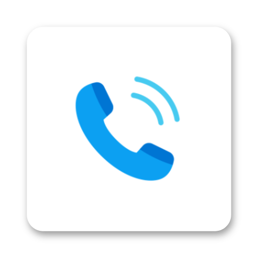

# Rivo

A clean, modern dialer and contacts app for Android, built with Jetpack Compose.

[](https://www.android.com)
[](https://developer.android.com/jetpack/compose)
[](https://crowdin.com/project/rivophone)

<p align="center">
  <a href="https://play.google.com/store/apps/details?id=com.grinch.rivo4">
    
  </a>
  &nbsp;
  <a href="https://github.com/user-grinch/RivoPhoneApp/releases/download/preview/RivoPhone.apk">
    
  </a>
</p>

<p align="center">
  <a href="https://play.google.com/store/apps/details?id=com.grinch.rivo4">
    
  </a>
  &nbsp;
  <a href="https://discord.gg/NtEvU3726e">
    
  </a>
  &nbsp;
  <a href="https://www.patreon.com/c/grinch_">
    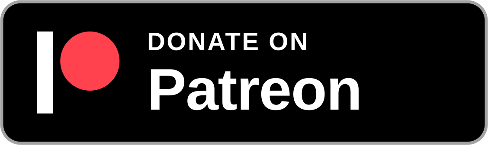
  </a>
  &nbsp;
  <a href="#Donation">
    
  </a>
  <br>
</p>

> [!NOTE]  
> **Preview Builds:** Automated preview APKs are compiled directly from the latest codebase and published under **[Releases](https://github.com/user-grinch/RivoPhoneApp/releases)**. You can also join our **[Discord Server](https://discord.gg/NtEvU3726e)** to test upcoming features and chat with the community!

</div>

---

## Features

- **T9 Search & Speed Dial**: Quick contact lookup by name or number right on the keypad, plus 1–9 speed dial shortcuts.
- **Dual SIM Support**: Outbound SIM selector, per-contact preferred SIM memory, and carrier tags.
- **Call Recording**: Built-in call audio recording with playback management, custom save directory, and auto-record rules.
- **In-Call Screen**: Audio routing (earpiece, speaker, Bluetooth, wired headset), hold, mute, in-call dialpad, and call notes.
- **Call Notifications**: Android-native heads-up notifications with answer, decline, and speaker toggles.
- **Private Contacts Vault**: Keep specific contacts, their call history, and notifications locked behind biometrics or device PIN.
- **Contact Management**: Edit multiple numbers, emails, and addresses per contact with custom labels, contact deduplication, and local or cloud account storage.
- **Fake Incoming Call**: Simulate an incoming call with custom caller name, number, ringtone, and timer.
- **Blocklist**: Block spam numbers directly from call logs or contact details.
- **Customization**: Material You dynamic color theming, configurable dialpad layouts, avatar shapes, and app-level biometric lock.

## Screenshots

<p align="center">
  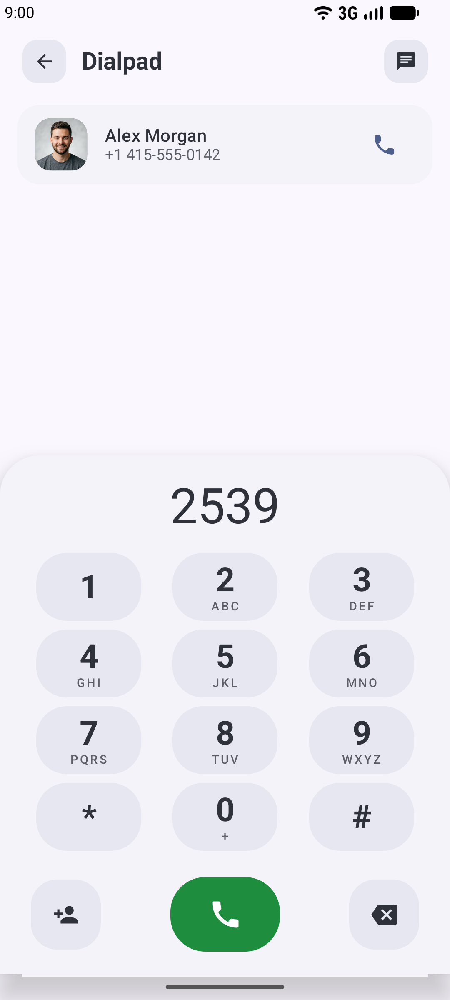
  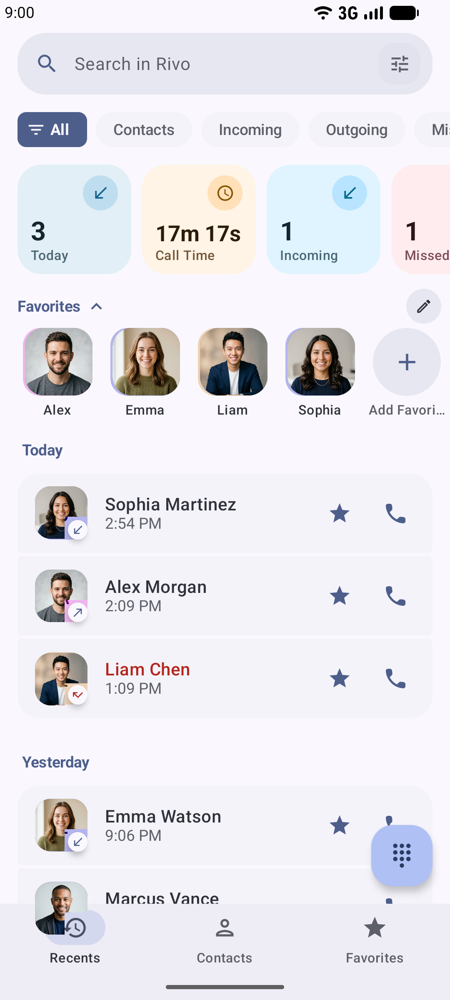
  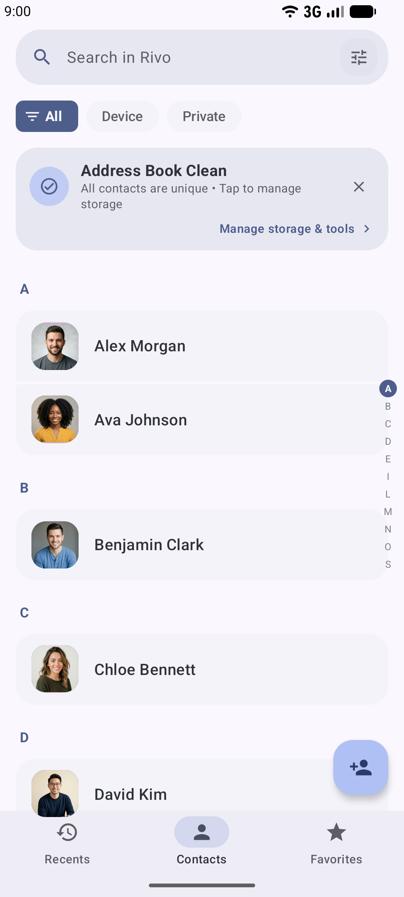
</p>
<p align="center">
  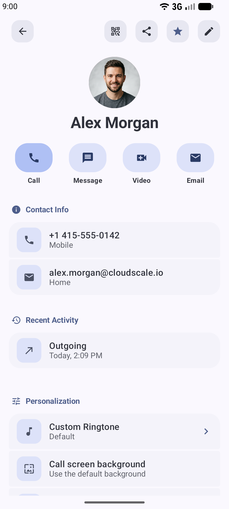
  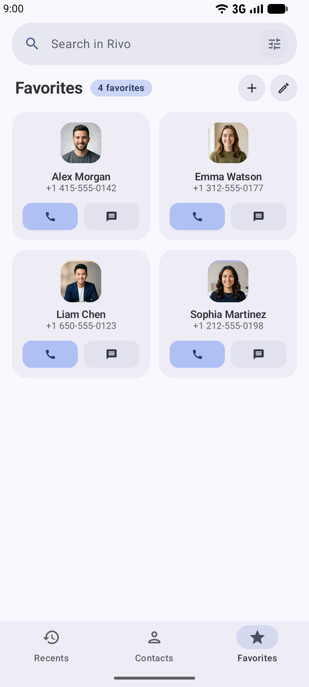
  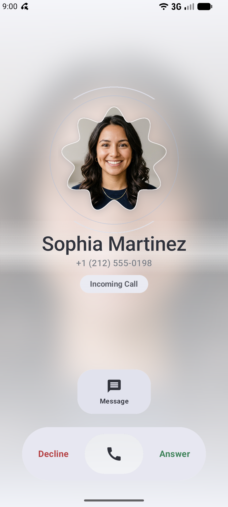
</p>
<p align="center">
  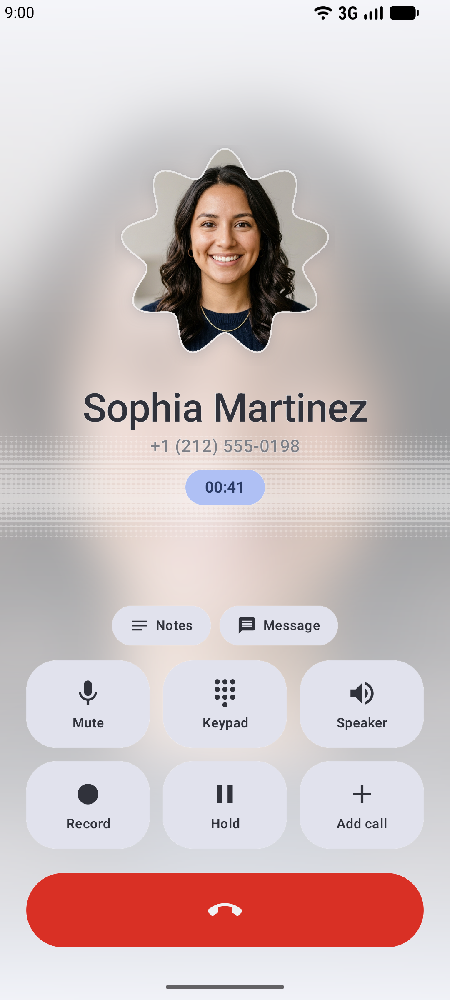
  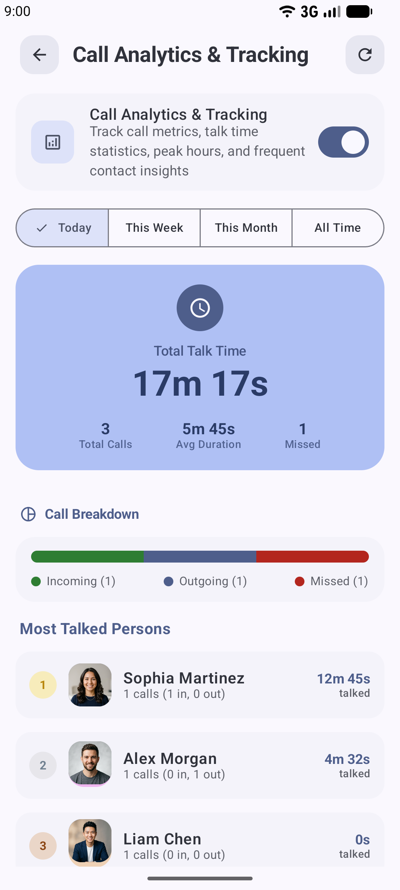
  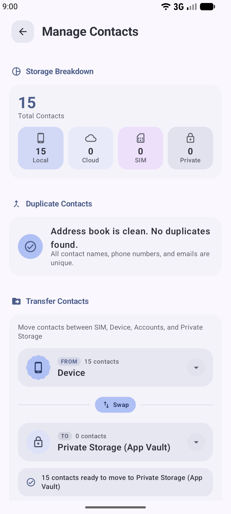
</p>
<p align="center">
  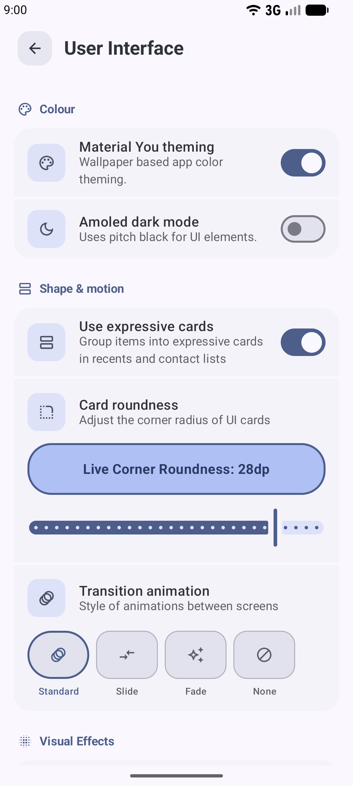
  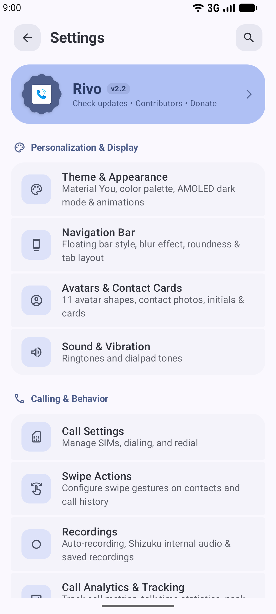
</p>

---

## Downloads

- **Google Play (Recommended)**: Download the official stable release from [Google Play](https://play.google.com/store/apps/details?id=com.grinch.rivo4).
- **Preview Builds (Direct APK)**: Direct APK builds compiled directly from the latest `main` branch are published under [Releases](https://github.com/user-grinch/RivoPhoneApp/releases).
  - Download [RivoPhone.apk (Preview)](https://github.com/user-grinch/RivoPhoneApp/releases/download/preview/RivoPhone.apk)
- **Discord Community**: Join our [Discord Server](https://discord.gg/NtEvU3726e) to discuss upcoming features, test beta builds, and report issues.

<details>
<summary><b>APK Signing Certificate Hash (SHA-256)</b></summary>

```text
Package: com.grinch.rivo4
SHA-256: AF:7B:C8:10:1A:C9:D7:4B:93:5B:31:4B:71:C7:EE:1D:ED:0F:9D:45:AB:07:4C:72:7F:82:11:89:F4:56:50:C5
```
</details>

## Donation

If you enjoy Rivo and would like to support its continued development:

- **Patreon**: Support monthly on [Patreon](https://www.patreon.com/c/grinch_)
- **Google Play**: Use the in-app tip jar located in **Settings $\rightarrow$ Support Development**

---

<div align="center">

Made with care by [Grinch](https://github.com/user-grinch)

</div>
